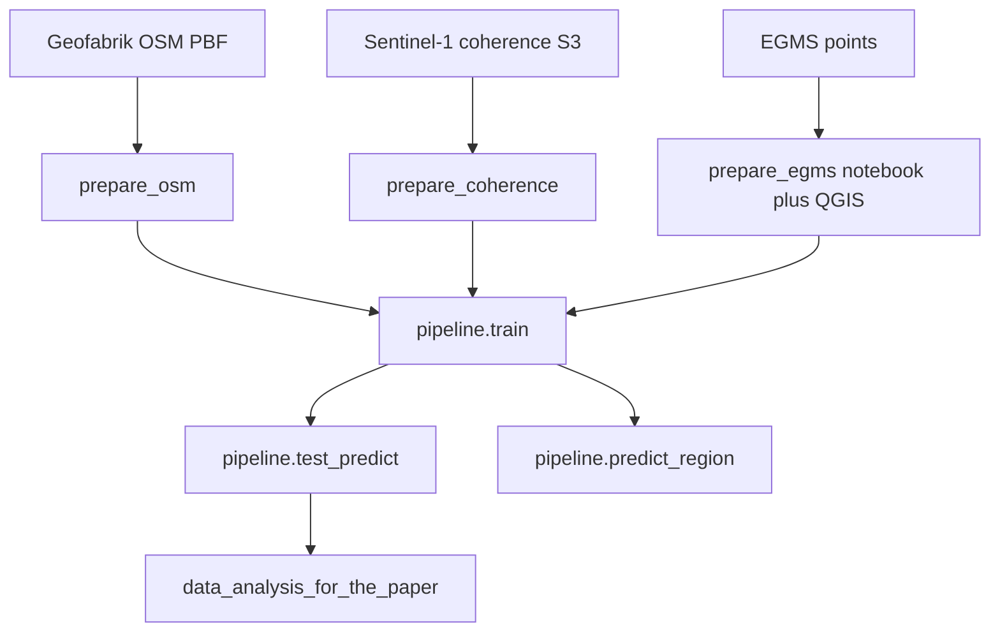

# PredictPS

Pixel-wise prediction of persistent scatterer (PS) density from Sentinel-1 global coherence rasters and OpenStreetMap infrastructure maps.

## How to cite

This repository contains code required to reproduce results for the paper entitled "" (DOI ).

Research data: .

See also [CITATION.cff](CITATION.cff).

## Data availability

Input data, intermediate files, and outputs that reproduce the paper are published on Zenodo.

**DOI:**

Download and extract the archive, then set `data_root` to the extracted directory (see Configuration). Folder names match [`config/paths.example.yaml`](config/paths.example.yaml). Required file names are listed under Required inputs.

## Installation

Requires Python 3.9.18 on Linux x86_64. The lockfile installs the PyTorch 2.0.1 CUDA 11.8 wheel (`torch==2.0.1+cu118`), not the CPU wheel from PyPI. macOS, native Windows, and CPU-only machines cannot use this lockfile as-is.

A CUDA GPU is required to train, test, or predict. `ps_density.pipeline.train`, `ps_density.pipeline.test_predict`, and `ps_density.pipeline.predict_region` build a Lightning trainer with `accelerator="gpu"`. Importing the package does not need a GPU or any rasters.

```bash
poetry install
```

Check the environment:

```bash
poetry run python -c "import torch, ps_density; print(torch.__version__, torch.cuda.is_available())"
```

Optional Jupyter kernel for the notebooks:

```bash
poetry install --with dev
```

`osmconvert` and the AWS CLI are external programs. Install `osmconvert` and put it on `PATH`, or set `predict.osmconvert` in `config/paths.yaml` to the binary path. The AWS CLI is used to download public coherence tiles (`aws s3 cp --no-sign-request`); no AWS credentials are required.

OpenStreetMap `.osm.pbf` extracts are **not** downloaded by the repository scripts. Download them yourself from [Geofabrik](https://download.geofabrik.de/). The published training data used a Geofabrik Netherlands build from **26 October 2023**.

## Configuration

File paths are defined in `config/paths.yaml`. The committed template is `config/paths.example.yaml`. Change values there rather than in scripts.

**Setup (first time):**

```bash
cp config/paths.example.yaml config/paths.yaml
# Edit config/paths.yaml and set data_root to the extracted Zenodo directory
```

**Quick override** (without editing the file):

```bash
export PREDICTPS_DATA_ROOT=/path/to/extracted_zenodo_archive
```

**Custom config file:**

```bash
export PREDICTPS_PATHS_FILE=/path/to/my_paths.yaml
```

`config/paths.yaml` is gitignored. Rasters, checkpoints, and `.venv/` are not committed.

TorchGeo accepts one GeoTIFF or a directory of `*.tif` files. Coherence for train and test is the `tiles/` directory of 1×1 degree GeoTIFFs. TorchGeo indexes every tile in that folder, and `random_bbox_splitting` takes 70% / 15% / 15% of **each** file. That is the paper split. Pointing coherence at the single mosaic makes the whole Netherlands one file, so the same fractions cover different ground and the test MAE changes (86 batches and about 0.84, instead of 97 batches and 1.19 for seed 54321). OSM and the EGMS mask stay one GeoTIFF each.

`config/paths.yaml` is grouped by workflow (`prepare`, `train`, `test`, `predict`, `paper`). Fill only the block for the script you are running. Train and test share the coherence tiles directory and the OSM and EGMS mask files.

**In Python scripts or notebooks:**

```python
from ps_density.config.paths import load_paths

cfg = load_paths()
coherence_tiles = cfg.train.input.coherence_summer
osm_tif = cfg.train.input.osm
mask_tif = cfg.train.input.mask_egms
```

## Required inputs

Before running a step, set `data_root` in `config/paths.yaml` (or `PREDICTPS_DATA_ROOT`) to the extracted Zenodo directory. Paths match `config/paths.example.yaml`. Nothing below is in git.

### Prepare training inputs

| Path / setting | Used in |
| --- | --- |
| `prepare.aoi_lon`, `prepare.aoi_lat`, optional `exclude_tiles` | Coherence and OSM tile lists |
| `prepare.osm_pbf` | OSM clip/rasterize (one `.osm.pbf` or a directory of them) |
| `prepare.egms_links_txt` | EGMS link-list filter |
| `prepare.egms_shp_dir` | EGMS shapefile merge |
| `train.input.coherence_summer` | Directory of 1×1 degree tiles written by prepare_coherence |
| `train.input.osm` | Mosaic written by prepare_osm |
| `train.input.mask_egms` | Density GeoTIFF written in QGIS after prepare_egms |

The Zenodo deposit includes `OSM_combined.tif`, the infrastructure raster used for training. It also includes three Geofabrik extracts from 26 October 2023 so the preparation script can be tried: `netherlands-latest.osm.pbf`, `drenthe-latest.osm.pbf`, and `nordrhein-westfalen-latest.osm.pbf`. These extracts and the raster are derived from OpenStreetMap data © OpenStreetMap contributors, available under the Open Database License.

### Train

| Path | Used in |
| --- | --- |
| `train.input.coherence_summer` | 1×1 tiles directory |
| `train.input.osm` | Infrastructure GeoTIFF |
| `train.input.mask_egms` | EGMS density GeoTIFF |
| `train.output.results_dir` | Checkpoints and TensorBoard logs |
| CUDA GPU | Lightning trainer |

### Test on the Netherlands (and Rome)

| Path | Used in |
| --- | --- |
| `test.input.coherence_summer`, `osm`, `mask_egms` | Same stack as training |
| `test.checkpoint` | Local `.ckpt`, or empty to download from Hugging Face (`dominika-malinowska/ps_predictions`) |
| `test.checkpoints.one_channel` | One-channel comparison (local file) |
| `test.input.google_satellite_dir` | Optional RGB context for review plots |
| `test.output.results_dir` | Netherlands test GeoTIFF |
| `test.output.plots_dir` | Netherlands review JPEGs |
| `test.rome.*` | Rome transfer rasters, `results_dir`, and `plots_dir` |

With the 20 Netherlands tiles, seed 54321, and the paper checkpoint, the test loader has 97 batches and `test_MAE` is 1.193.

### Predict one 1×1 degree tile

| Path | Used in |
| --- | --- |
| `predict.aoi_lon`, `predict.aoi_lat` | Area of interest (must sit inside one 1×1 degree tile) |
| `predict.osm_pbf` | Geofabrik `.pbf` for the area of interest (not downloaded) |
| `predict.checkpoint` | Local `.ckpt`, or empty to download from Hugging Face (`dominika-malinowska/ps_predictions`) |
| `predict.osmconvert` | osmconvert binary |
| `predict.output.results_dir` | Tile folder and `{lat}{lon}_PS_pred.tif` |
| AWS CLI | Public coherence download |
| CUDA GPU | Inference |

### Paper figures

The `paper:` block is not required to train or predict. `ps_density.pipeline.data_analysis_for_the_paper` writes to `paper.plots_dir` and reads the GeoTIFFs listed under `paper.input`.

**Coherence mosaics.** Training uses summer only (`train.input.coherence_summer` is the `tiles/` directory from Step 1; the summer mosaic sits beside it as `summer_vv_rho.tif`). The paper figures also need spring, fall, and winter mosaics. If any of `paper.input.coherence_*` is missing, Step 7 calls `prepare_data.prepare_coherence` with that `--season` (same `prepare.aoi_*` tiles, AWS CLI). You can also run it yourself, for example:

```bash
poetry run python -m ps_density.prepare_data.prepare_coherence --season spring
```

Without `--output`, `summer` in the training path is replaced by the season so files are not mixed into the summer tiles folder. Step 7 passes `--output` as the mosaic path in `paper.input`.

**NDVI.** Summer and winter mean and standard-deviation rasters are on Zenodo under `input/NDVI/` (`mean_ndvi_S2_su_nan_filled_resized.tif`, `mean_ndvi_S2_wi_nan_filled_resized.tif`, `std_ndvi_S2_su_nan_filled_resized.tif`, `std_ndvi_S2_wi_nan_filled_resized.tif`). They were built from Sentinel-2 in Google Earth Engine: NDVI from 10 m NIR and red, scenes with less than 50% cloud cover in the same seasonal windows as the global coherence product, remaining clouds and shadows masked, then mean and standard deviation over each season. Rasters were later gap-filled and resampled to the other layers’ grid (that step is not in this repository). The GEE script is not published; use the Zenodo GeoTIFFs.

**OSM class rasters.** The combined infrastructure map used for training and paper figures is the Zenodo file `input/OSM/OSM_combined.tif` (`train.input.osm` / `paper.input.osm`). `prepare_osm` writes a timestamped copy and does not replace that file. Paper figures also need one raster per class. Those files are on Zenodo under `input/OSM/separate/` (`buildings.tif`, `railway.tif`, `highway.tif`, `highway_motorway.tif`, `highway_trunk.tif`, `highway_primary.tif`, `highway_secondary.tif`). They use the same OSM tags as `prepare_osm` (buildings, rail, motorway, trunk, primary, secondary) but each class is rasterized on its own (`highway.tif` is all four road types together). `prepare_osm` does not write these files; primary and secondary cannot be recovered from `OSM_combined.tif` because both share the value 0.59. Use the Zenodo GeoTIFFs.

**Merged predictions.** Paper figures use the Zenodo mosaics `results_test/merged_prediction_NL.tif` and `results_test_rome/merged_prediction_Rome.tif` (`paper.input.pred_nl` and `paper.input.pred_rome`). A new run of `pipeline.test_predict` writes `merged_prediction_NL_YYYYMMDD_HHMMSS.tif` and `merged_prediction_Rome_YYYYMMDD_HHMMSS.tif` in the same folders so those originals are not overwritten.

**Other paper rasters** are not downloaded by the scripts. Place the Rome EGMS mask at `paper.input.rome_mask`. The EGMS density raster can be the same file as `train.input.mask_egms`.

**EGMS points for Fig. 15c–d.** The points in `paper.input.egms_plots_dir` were obtained from the EGMS PS product. Only the pickles are provided (`underestimation.pkl` and `overestimation.pkl`), because the shapefiles are too large. Step 7 reads a pickle when it is present.

## Running the pipeline

Run every step from the repository root after `poetry install` and after `data_root` is set:

```bash
poetry run python -m ps_density.<package>.<module>
```

Optional, after `poetry install` and with no rasters or `data_root`: confirm that the package imports.

```bash
poetry run python -c "import ps_density"
```

### Prepare training rasters

**Step 1.** `prepare_data.prepare_coherence` — Downloads `summer_vv_rho` tiles from the public Sentinel-1 global coherence bucket and mosaics them. Pass `--season`, `--polarisation`, or `--metric` to change the product.

**Input:** `prepare.aoi_`*, AWS CLI. **Output:** tiles in `train.input.coherence_summer` and a mosaic beside that directory.

```bash
poetry run python -m ps_density.prepare_data.prepare_coherence
```

**Step 2.** `prepare_data.prepare_osm` — Clips `prepare.osm_pbf` per tile with `osmconvert`, rasterizes buildings/roads/rail, and mosaics the tiles. The script does not fetch Geofabrik extracts. Training uses the published `OSM_combined.tif`. A new run writes `OSM_combined_YYYYMMDD_HHMMSS.tif` (and `tiles_YYYYMMDD_HHMMSS/`) beside it so the Zenodo mosaic is not overwritten. The bundled Geofabrik extracts are a subset of those used for the paper map.

**Input:** `prepare.osm_pbf`, `osmconvert`. **Output:** timestamped mosaic next to `train.input.osm`.

```bash
poetry run python -m ps_density.prepare_data.prepare_osm
```

**Step 3.** `prepare_data/prepare_egms.ipynb` — Filters the EGMS link list and merges split shapefiles. The EGMS website download and the QGIS density conversion stay manual (see the notebook). Training reads the GeoTIFF named in `train.input.mask_egms`.

Open the notebook in the Poetry environment (`poetry install --with dev`).

### Train

**Step 4.** `pipeline.train` — Trains the 2-channel U-Net (coherence + OSM) on the Netherlands stack.

**Input:** `train.input.`*, CUDA GPU. **Output:** checkpoints under `train.output.results_dir`. TensorBoard logs go in that directory's `logs/` folder.

```bash
poetry run python -m ps_density.pipeline.train
```

Inspect the stack first in `src/ps_density/pipeline/notebooks/train.ipynb`. That notebook also writes Fig. 2 (`fig2.jpg`) via `plot_sampling_map`.

### Test

**Step 5.** `pipeline.test_predict` — Netherlands test MAE, review plots, one-channel comparison, and Rome transfer.

**Input:** `test.input.`*, paper checkpoint, optional Rome rasters. **Output:** `test.output.results_dir`, review plots in `test.output.plots_dir`, Rome GeoTIFFs in `test.rome.results_dir`, Rome plots in `test.rome.plots_dir`.

```bash
poetry run python -m ps_density.pipeline.test_predict
```

Inspect a few patches in `src/ps_density/pipeline/notebooks/test_predict.ipynb`.

### Predict a new region

**Step 6.** `pipeline.predict_region` — Predicts one new 1×1 degree tile. Coherence season is summer in the northern hemisphere and winter in the southern hemisphere.

**Input:** `predict.osm_pbf`, paper checkpoint (Hugging Face unless `predict.checkpoint` is set), osmconvert, AWS CLI, CUDA GPU. **Output:** `{lat}{lon}_PS_pred.tif` under `predict.output.results_dir`.

```bash
poetry run python -m ps_density.pipeline.predict_region
```

Preview inputs in `src/ps_density/pipeline/notebooks/predict_region.ipynb`.

### Paper figures

**Step 7.** `pipeline.data_analysis_for_the_paper` — Reads `paper.input` (the published rasters). Original EPS stay in `paper.plots_dir` (`results_paper/`). A new run writes `results_paper_YYYYMMDD_HHMMSS/`. Missing seasonal coherence mosaics are built with `prepare_data.prepare_coherence` (AWS CLI).

```bash
poetry run python -m ps_density.pipeline.data_analysis_for_the_paper
```

## Pipeline overview



## Repository structure

```text
src/ps_density/
├── config/                         # Path configuration loader
├── utils/                          # Shared helpers (not run directly)
├── pipeline/                       # Train, test, predict, paper figures
│   └── notebooks/                  # Optional plots for the same steps
└── prepare_data/                   # Coherence download, OSM rasterize, EGMS notebook

config/paths.example.yaml           # Path template (committed)
config/paths.yaml                   # Your local paths (gitignored)
data/                               # Optional local data root; rasters are not committed
```

### Modules that are not run directly

These are imported by pipeline scripts; do not invoke them with `poetry run python -m ...`:

| Location | Purpose |
| --- | --- |
| `utils/model_setup.py` | Lightning trainer and datamodule setup |
| `utils/model_checkpoint.py` | Hugging Face or local paper checkpoint |
| `utils/torchgeo_classes_def.py` | U-Net regression task and GeoDataModule |
| `utils/torchgeo_fun_to_read_input.py` | Raster dataset classes and coherence scaling |
| `utils/preprocessing_OSM_data.py` | osmconvert clip and infrastructure value map |
| `utils/prediction_plots.py` | Georeferenced chips, mosaic merge, review plots |
| `utils/sampling_maps.py` | Train/val/test chip map |
| `utils/plotting_scatter_with_3rd_dim.py` | Density scatter plots for paper figures |
| `utils/coordinates_selection.py` | Interactive AOI helper; pipeline uses `haversine_distance` |
| `config/paths.py` | Loads `config/paths.yaml` |

## Pipeline I/O reference

| Step | Script | Reads | Writes |
| --- | --- | --- | --- |
| 1 | `prepare_data.prepare_coherence` | `prepare.aoi_*`, public S3 tiles | `train.input.coherence_summer` tiles and mosaic |
| 2 | `prepare_data.prepare_osm` | `prepare.osm_pbf` | timestamped mosaic next to `train.input.osm` |
| 3 | `prepare_data/prepare_egms.ipynb` | `prepare.egms_links_txt`, `prepare.egms_shp_dir` | filtered link list, merged shapefiles; QGIS writes `train.input.mask_egms` |
| 4 | `pipeline.train` | `train.input.*` | checkpoints under `train.output.results_dir` |
| 5 | `pipeline.test_predict` | `test.input.*`, checkpoint, optional `test.rome.*` | `results_test` / `results_test_rome` GeoTIFFs and plots |
| 6 | `pipeline.predict_region` | `predict.*`, OSM PBF, public coherence tile | `{lat}{lon}_PS_pred.tif` under `results_predict_region` |
| 7 | `pipeline.data_analysis_for_the_paper` | `paper.input` GeoTIFFs | timestamped folder beside `paper.plots_dir` |

## Paper figures

Every figure is on Zenodo. Only some can be remade from this repository; the rest were drawn in QGIS or as a flowchart and are not generated here.

Step 7 (`pipeline.data_analysis_for_the_paper`) writes PNG files into a timestamped folder beside `paper.plots_dir` (default `{data_root}/results_paper/`) so the published set is not overwritten. Review patches from Step 5 keep the original `model_pred_b{batch}_{i}.jpg` name and also a `fig*.jpg` copy.

Published review folders on Zenodo:

- Netherlands 2-channel: `results_test/plots/test_pred_54321_20231214_2in/`
- Netherlands 1-channel: `results_test/plots/test_pred_54321_20231218_1in/`
- Rome: `results_test_rome/plots/test_pred_54321_20231218_1in/` (folder name is historical; the panels are the 2-channel model. A new run writes `review_Rome_2channel_*`)

A new Step 5 run writes timestamped `review_NL_2channel_*`, `review_NL_1channel_*`, and `review_Rome_2channel_*` instead of those names.

| Paper figure | Recreate? | Source |
| --- | --- | --- |
| Fig. 1 | No | Flowchart on Zenodo only |
| Fig. 2 | Yes | `src/ps_density/pipeline/notebooks/train.ipynb` (`plot_sampling_map`, `fig2.jpg`) |
| Fig. 3a | Yes | Step 7, `fig3a.png` |
| Fig. 3b | No | QGIS map of `input/OSM/OSM_combined.tif` |
| Fig. 4a | Yes | Step 7, `fig4a.png` |
| Fig. 4b | No | QGIS map of `input/EGMS/egms_point_denisty.tif` |
| Fig. 5a–f | Yes | Step 7, `fig5a.png` … `fig5f.png` |
| Fig. 6a–d | Yes | Step 5, Netherlands 2-channel review plots (see mapping below) |
| Fig. 7a–b | Yes | Step 7, `fig7a.png`, `fig7b.png` |
| Fig. 8 | Yes | Step 7, `fig8.png` |
| Fig. 9 | Yes | Step 7, `fig9.png` |
| Fig. 10a–f | No | QGIS maps of long-term coherence and summer/winter mean and standard-deviation NDVI rasters |
| Fig. 11a–l | Yes | Step 7, `fig11a.png` … `fig11l.png` |
| Fig. 12a–b | Yes | Step 5, Rome 2-channel review plots |
| Fig. 13a–b | Yes | Step 5, same chips from the 2-channel and 1-channel Netherlands runs (`fig13a_2in` / `fig13a_1in`, `fig13b_2in` / `fig13b_1in`) |
| Fig. 14a–c | Yes | Step 5, Netherlands 2-channel review plots |
| Fig. 15a–b | Yes | Step 5, Netherlands 2-channel review plots |
| Fig. 15c–d | Yes | Step 7, `fig15c.png`, `fig15d.png` |
| Supplementary regressions | Yes | Step 7 (commented in the script): `linear_regression_1in.png`, `poly_regression_1in.png` |

Review-plot mapping (`model_pred_b{batch}_{patch}.jpg` → paper name). None of these IDs is used twice except Fig. 13, where the same chips are plotted once per model:

| Paper file | Original JPEG | Published folder |
| --- | --- | --- |
| `fig6a.jpg` | `model_pred_b0_13.jpg` | `test_pred_54321_20231214_2in` |
| `fig6b.jpg` | `model_pred_b2_6.jpg` | `test_pred_54321_20231214_2in` |
| `fig6c.jpg` | `model_pred_b33_0.jpg` | `test_pred_54321_20231214_2in` |
| `fig6d.jpg` | `model_pred_b49_0.jpg` | `test_pred_54321_20231214_2in` |
| `fig12a.jpg` | `model_pred_b13_11.jpg` | Rome `test_pred_54321_20231218_1in` |
| `fig12b.jpg` | `model_pred_b5_6.jpg` | Rome `test_pred_54321_20231218_1in` |
| `fig13a_2in.jpg` | `model_pred_b49_8.jpg` | `test_pred_54321_20231214_2in` |
| `fig13a_1in.jpg` | `model_pred_b49_8.jpg` | `test_pred_54321_20231218_1in` |
| `fig13b_2in.jpg` | `model_pred_b2_15.jpg` | `test_pred_54321_20231214_2in` |
| `fig13b_1in.jpg` | `model_pred_b2_15.jpg` | `test_pred_54321_20231218_1in` |
| `fig14a.jpg` | `model_pred_b14_4.jpg` | `test_pred_54321_20231214_2in` |
| `fig14b.jpg` | `model_pred_b4_11.jpg` | `test_pred_54321_20231214_2in` |
| `fig14c.jpg` | `model_pred_b3_0.jpg` | `test_pred_54321_20231214_2in` |
| `fig15a.jpg` | `model_pred_b47_15.jpg` | `test_pred_54321_20231214_2in` |
| `fig15b.jpg` | `model_pred_b25_9.jpg` | `test_pred_54321_20231214_2in` |

## External dependencies

- `osmconvert` on `PATH` (or `predict.osmconvert`)
- AWS CLI, for public Sentinel-1 global coherence (`aws s3 cp --no-sign-request`)
- Geofabrik [`.osm.pbf`](https://download.geofabrik.de/) extracts
- EGMS portal download and QGIS density conversion
- Hugging Face checkpoint `dominika-malinowska/ps_predictions` (`seed_54321_20231214-203338.ckpt`) unless `test.checkpoint` or `predict.checkpoint` points at a local file

## License

MIT. See [LICENSE](LICENSE).
